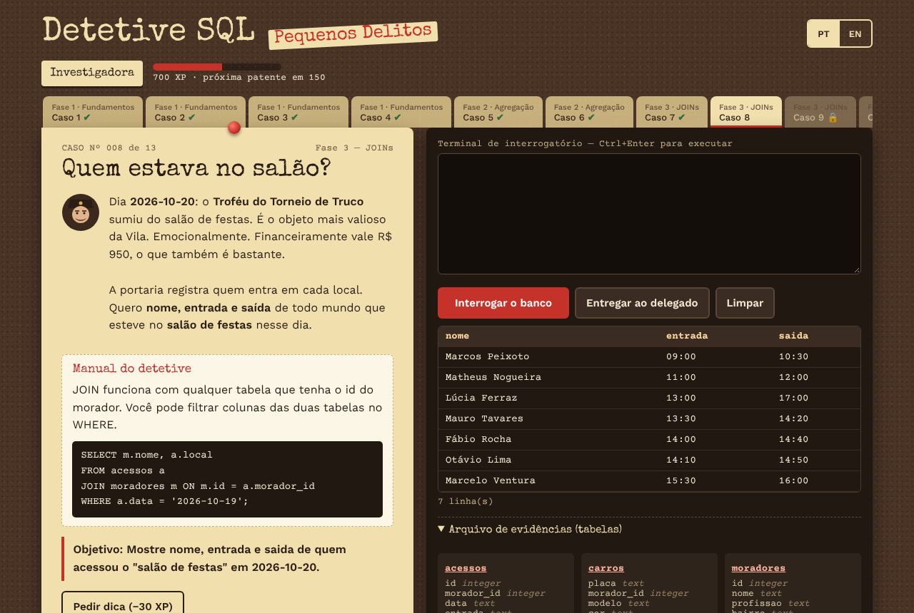
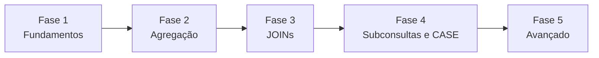
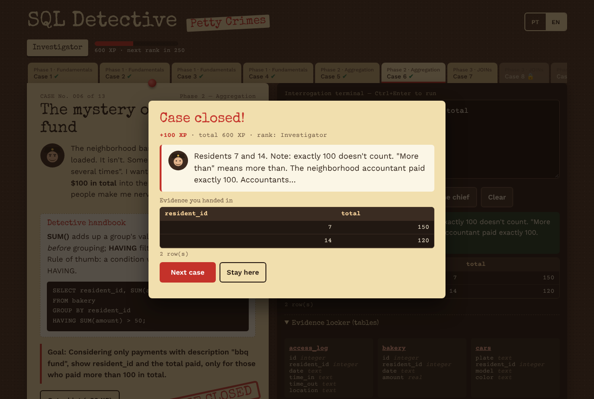
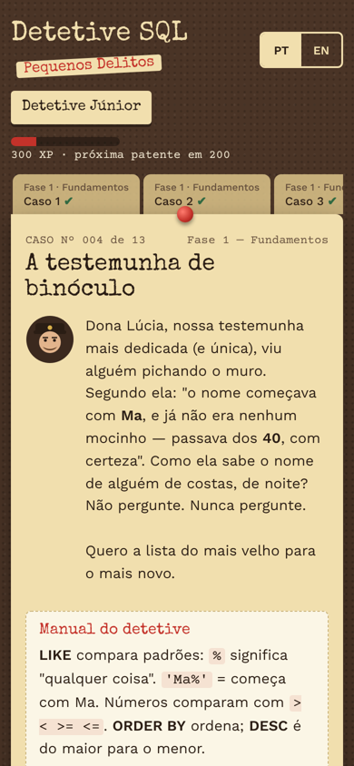

<div align="center">

# Detetive SQL

**Aprenda SQL resolvendo pequenos crimes na Vila Pacata.**
*Learn SQL by solving petty crimes in Vila Pacata.*

[](https://duarrt.github.io/detetive-sql/?lang=pt)
[](https://duarrt.github.io/detetive-sql/?lang=en)


[Português](#português) · [English](#english)



</div>

---

## Português

### Sobre

Você é a nova detetive da **Divisão de Pequenos Delitos** da Vila Pacata, onde o crime é pequeno, mas o drama é gigante. O sarcástico **Delegado Bastos** te passa os casos: um iogurte sumido da geladeira, uma vaquinha de churrasco que não fecha a conta, um troféu de truco desaparecido. Para resolver cada um, você interroga o banco de dados da vila com SQL.

O jogo vai do primeiro `SELECT *` até CTEs e funções de janela, sem precisar instalar nada.

### Como jogar

1. Leia a ficha do caso: a história, o **Manual do detetive** (a lição) e o **objetivo**.
2. Escreva a consulta no **terminal de interrogatório** e execute com `Ctrl+Enter`.
3. Consulte o **arquivo de evidências** para ver tabelas e colunas. Clicar numa tabela mostra as primeiras linhas.
4. Quando o resultado estiver certo, clique em **Entregar ao delegado**.
5. Travou? Cada dica custa 30 XP, e ver a solução deixa o caso valendo 10 XP.

| Uso de ajuda | XP do caso |
|---|---:|
| Nenhuma | 100 |
| 1 dica | 70 |
| 2 dicas | 40 |
| Solução | 10 |

O XP leva às patentes: *Estagiária do Arquivo Morto → Detetive Júnior → Investigadora → Inspetora → Delegada-Chefe*.

### Os casos



| # | Caso | O que você aprende |
|---:|---|---|
| 1 | Primeiro dia na delegacia | `SELECT`, `FROM` |
| 2 | Só o necessário, por favor | Escolher colunas |
| 3 | Onda de furtos na Vila Nova | `WHERE`, `AND` |
| 4 | A testemunha de binóculo | `LIKE`, comparações, `ORDER BY` |
| 5 | Estatística para o prefeito | `COUNT`, `GROUP BY` |
| 6 | O mistério da vaquinha | `SUM`, `HAVING` |
| 7 | Dando nome aos bois | `JOIN` |
| 8 | Quem estava no salão? | `JOIN` com filtros nas duas tabelas |
| 9 | O ladrão a pé | `LEFT JOIN` + `IS NULL` |
| 10 | Acima da média | Subconsulta, `AVG` |
| 11 | Classificação de gravidade | `CASE WHEN` |
| 12 | O rei da padaria | `WITH` (CTE), `RANK() OVER` |
| 13 | Caso final | Tudo junto |

<div align="center">

&nbsp;

</div>

### Recursos

- **Dois idiomas:** português (pt-BR) e inglês (en-US), com botão PT/EN no topo. Na versão em inglês, o banco também é traduzido: tabelas, colunas e valores.
- **Correção pelo resultado:** a resposta vale se o resultado bater com o esperado, então caminhos diferentes para a mesma resposta são aceitos.
- **Erros traduzidos:** as mensagens do SQLite viram explicações em português, com o humor do delegado.
- **Exploração livre:** dá para rodar qualquer consulta. Comandos que alteram dados (`INSERT`, `UPDATE`, `DELETE`, `DROP`…) rodam e a vila volta ao estado original logo depois.
- **Progresso salvo** no navegador, compartilhado entre os dois idiomas.
- **Funciona no celular.**

### Privacidade e segurança

- Tudo roda no navegador. Não há servidor nem banco de dados remoto.
- Fontes, [sql.js](https://github.com/sql-js/sql.js) e o script do [GoatCounter](https://www.goatcounter.com/) são servidos pelo próprio site.
- Sem cookies, login, formulários ou anúncios. A contagem de visitas usa o GoatCounter, que não usa cookies; o único envio para fora é esse registro de visita.
- Content Security Policy restritiva, sem scripts embutidos no HTML.
- Políticas de privacidade: [pt-BR](privacidade.html) · [en-US](privacy.html).

### Rodar localmente

É um site estático:

```bash
git clone https://github.com/Duarrt/detetive-sql.git
cd detetive-sql
python3 -m http.server 8000
# abra http://localhost:8000
```

> Abrir o `index.html` com dois cliques não funciona: a política de segurança exige que os arquivos sejam servidos por HTTP.

### Estrutura

```
index.html          jogo
privacidade.html    política de privacidade (pt-BR)
privacy.html        privacy policy (en-US)
css/style.css       estilos e fontes locais
js/i18n.js          textos da interface (pt-BR e en-US)
js/data.js          banco e casos em pt-BR
js/data-en.js       banco e casos em en-US
js/game.js          lógica do jogo
vendor/sql.js/      sql.js 1.13.0 (build asm.js)
vendor/goatcounter/ count.js do GoatCounter (contagem de visitas)
fonts/              Special Elite, Courier Prime, Work Sans
docs/img/           imagens deste README
_headers            cabeçalhos para Cloudflare Pages / Netlify
```

### Criar novos casos

Cada caso é um objeto em `js/data.js`, com o equivalente em inglês na **mesma posição** de `js/data-en.js`:

```js
{
  fase: 2, faseNome: 'Agregação',
  titulo: 'Título do caso',
  historia: 'O que o delegado conta (aceita <b>HTML</b>)',
  conceito: 'A lição do Manual do detetive',
  exemplo: 'SELECT ... -- exemplo usando outra tabela',
  objetivo: 'O que a consulta precisa trazer',
  dicas: ['Dica 1', 'Dica 2'],
  solucao: 'SELECT ...',   // o resultado dela é o gabarito
  ordem: false,            // true se a ordem das linhas importa
  fim: 'A piada do delegado quando o caso é resolvido'
}
```

A resposta é aceita quando o resultado bate com o de `solucao`: mesmas colunas, na mesma ordem, e as mesmas linhas. O progresso é guardado pela posição do caso, então mantenha as duas listas com a mesma quantidade e ordem de casos.

### Créditos de terceiros

- [sql.js](https://github.com/sql-js/sql.js): licença MIT
- [GoatCounter count.js](https://github.com/arp242/goatcounter): licença ISC
- [Special Elite](https://fonts.google.com/specimen/Special+Elite): Apache 2.0
- [Courier Prime](https://fonts.google.com/specimen/Courier+Prime) e [Work Sans](https://fonts.google.com/specimen/Work+Sans): SIL Open Font License 1.1

Todos os moradores, crimes e bigodes da Vila Pacata são fictícios.

---

## English

### About

You're the newest detective in Vila Pacata's **Petty Crimes Division**, where the crimes are small but the drama is enormous. The sarcastic **Chief Bastos** hands you the cases: a yogurt that vanished from the shared fridge, a barbecue fund that doesn't add up, a missing card-tournament trophy. To crack each one, you interrogate the town's database with SQL.

The game takes you from your first `SELECT *` all the way to CTEs and window functions, with nothing to install.

**[Play now →](https://duarrt.github.io/detetive-sql/?lang=en)**

### How to play

1. Read the case file: the story, the **Detective handbook** (the lesson) and the **goal**.
2. Write your query in the **interrogation terminal** and run it with `Ctrl+Enter`.
3. Check the **evidence locker** for tables and columns. Clicking a table shows its first rows.
4. When the result looks right, click **Hand it to the chief**.
5. Stuck? Each hint costs 30 XP, and showing the solution drops the case to 10 XP.

13 cases in 5 phases: fundamentals (`SELECT`, `WHERE`, `LIKE`, `ORDER BY`), aggregation (`COUNT`, `SUM`, `GROUP BY`, `HAVING`), joins (`JOIN`, `LEFT JOIN`), subqueries and `CASE`, and advanced queries (CTEs, `RANK() OVER`).

### Highlights

- Fully translated: in the English version, the database itself (tables, columns and values) is in English too.
- Answers are graded by their result, so any correct query passes.
- Runs entirely in the browser: no server, no cookies, no sign-up. Visits are counted with cookie-free GoatCounter.
- Progress saved locally and shared across both languages.

### Run locally

```bash
git clone https://github.com/Duarrt/detetive-sql.git
cd detetive-sql
python3 -m http.server 8000
# open http://localhost:8000/?lang=en
```

See the Portuguese section above for the project structure and how to add new cases. Each case in `js/data.js` has an English counterpart at the same position in `js/data-en.js`.

All residents, crimes and mustaches in Vila Pacata are fictional.
